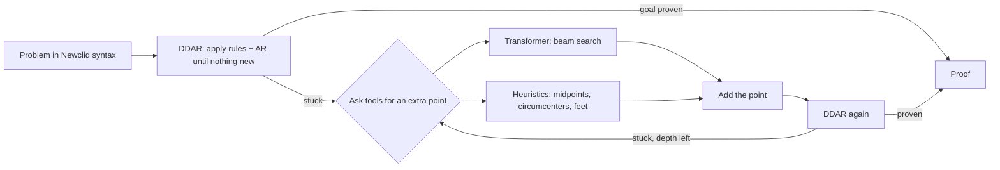

# How to understand and present this project

## The one-minute version

> We built a scanner for olympiad geometry problems. You choose one geometry
> domain, meaning a set of theorems such as "circles and inscribed angles, no
> similar triangles". For every problem in a folder, the tool tells you whether
> it has an *easy* solution in that domain: one that uses only those theorems
> and at most one extra point. It shows the solution step by step, names the
> key extra point, and reports how much time and memory it took. Under the hood
> it is a laptop-sized AlphaGeometry: a strict logic engine (Newclid's DDAR)
> does the proving, while heuristics and a small transformer suggest extra
> points.

## Why it is interesting

* **Proofs are checkable.** DDAR only applies known theorems, so every proof it
  outputs is correct. Neither the model nor the heuristics can make a false
  claim; they can only suggest points.
* **A domain is just a switch.** A geometry domain is a set of rules (the
  theorems allowed), whether AR (algebra) is allowed, and which kinds of extra
  points may be added. All three are JSON switches, so the same problems can be
  scanned in many domains.
* **"Easy" is measurable.** It is defined as solved within the domain, with at
  most one extra point, inside a small budget. Proof length, number of rules
  used, time and memory then rank how easy each solution is.
* **It is small.** It runs on a CPU, the data is public, and the model is
  written from scratch, so results are reproducible without a datacenter.

## The picture to draw on the whiteboard



The search goes breadth-first and has hard limits: depth (how many extra points
in a row), branching (how many suggestions per step), the number of DDAR calls,
and time, memory and CPU for the whole solve. There is no random guessing.

## The parts, in the order they were built

| # | Part | One sentence | Where |
|---|---|---|---|
| 1 | DDAR | Newclid, the open-source AlphaGeometry engine, runs on CPU. Its C++ core (yuclid) solves 60/74 examples in 0.01–0.25 s. | `docs/ddar.md` |
| 2 | Rule toggling | A JSON list of enabled rules plus an AR switch, warnings when a rule set can't use some hypotheses, and a side-by-side comparison script. | `ddar/rule_config.py`, `ddar/compare_rules.py` |
| 3 | Transformer | A from-scratch GPT-style decoder with a geometry tokenizer, greedy and beam decoding, and save/load. | `geo-lm/` |
| 4 | Data | 100k problems that need an extra point, subsampled from GenesisGeo's 21.8M (public, Apache-2.0). | `datagen/` |
| 5 | Training | Configurable trainer with checkpoints, resume, logging and held-out evaluation; checked end to end on a tiny run. | `geo-lm/geo_lm/train.py` |
| 6 | Toolbox | One `Tool` interface, three tools (DDAR, model, heuristics), and the DDAR → propose → DDAR search. | `pipeline/` |
| 7 | `solve()` | One call that returns a result with proof, time, memory, depth, rules, tools and failure reason, with limits enforced from a separate process. | `pipeline/solve.py` |
| 8 | Translation | A guide for writing olympiad problems by hand, a numerical check that catches wrong translations, and a runner that prints a results table. | `docs/translation_guide.md` |
| 9 | Docs and tests | README and 64 tests (about 15 s). | `docs/README.md`, `tests/` |
| 11 | Problem store | Problems with metadata, plus every `solve()` result for each config and budget, kept in git and shown as a table. | `bench/`, `results/` |

## Key ideas, explained simply

* **DDAR** = *Deductive Database + Algebraic Reasoning*.
  * The deductive database repeatedly applies about 60 theorems ("if these two
    triangles are similar, these angles are equal") until no new fact appears.
  * Algebraic reasoning treats angles and ratios as linear equations and
    solves them ("angle chasing").
* **Auxiliary construction**: a point that is not in the statement but makes
  the proof possible. DDAR cannot invent points. That is the model's job.
* **Rule**: one named theorem, e.g. `r43` is the orthocenter theorem. Turning a
  rule off is like a student who doesn't know that theorem.
* **The numerical check**: every figure is also drawn with real coordinates.
  Claims are verified on the drawing, which catches translation mistakes
  before any proving starts.

## A 5-minute live demo

Run from the repo root with `.venv-newclid` activated. Each command takes seconds.

```bash
# 1. DDAR alone proves a classic: the reflection of the orthocenter lies on the circumcircle.
python -m pipeline.solve --config pipeline/configs/ddar_only.json \
  -s "a b c = triangle a b c; h = orthocenter h a b c; d = reflect d h b c ? cyclic a b c d"

# 2. Knowledge matters: the same orthocenter problem with and without the orthocenter theorem / AR.
python -m ddar.compare_rules -p orthocenter_consequence_aux ddar/configs/*.json

# 3. Translation mistakes are caught before solving.
python -m pipeline.check_figure -f problems/examples/wrong_translation.txt

# 4. A whole folder, with a results table (time, memory, depth, tools).
python -m pipeline.run_folder problems/examples --config pipeline/configs/heuristics_only.json --check
```

What to point out:
1. The proof is printed step by step, and each step names the rule or the
   algebra that justifies it.
2. Without `r43` or without AR, the same problem becomes unsolvable. Rule sets
   change what can be proved.
3. The wrong translation is reported as `fails in every drawing`.
4. The table reports measurable quantities for each problem. Those are the
   numbers to compare curricula with.

## Numbers worth quoting

* Newclid examples: 60/74 solved by the fast engine. All 7 unsolved ones need
  theorems that engine doesn't include.
* Data: 98,008 training and 1,992 validation examples, 100 tokens at the
  median; split by figure so the test figures are never seen in training.
* Model: about 11M parameters, 76-token vocabulary, 512-token context. A tiny
  0.1M version trains in about 1 minute on a CPU.
* `solve()` overhead: about 2 s and 180 MB per problem, mostly Python start-up.

## Honest limitations (say them before someone asks)

* **The real model is not trained yet.** On this 2-core CPU it would take
  about 14 h (one command, resumable). Until then, the extra points come from
  the heuristics.
* **The model speaks GenesisGeo's language.** It describes points by
  properties (`coll`, `perp`, ...). These are translated into Newclid
  constructions, and suggestions using angle equalities are currently dropped.
* **Two engines.** The fast C++ engine has its theorems compiled in. Rule
  toggling uses Newclid's Python engine, which needed three bug fixes and is
  much slower.
* **Benchmarks are small so far.** The goal is controlled comparisons, not
  state-of-the-art scores (AlphaGeometry and GenesisGeo solve most IMO
  geometry problems with far bigger models).

## How this connects to the research question

The project description (`apraksts.txt`) is a scanner that finds problems with
easy solutions in one geometry domain. Here that becomes concrete:
* a **domain** = a DDAR config (rules, AR) plus the allowed sources of extra
  points (heuristic kinds, the model);
* **easy** = solved with search depth 0 or 1 under a small budget, for example
  `"search": {"max_depth": 1}` and `--time 60`;
* a **scan** = `python -m bench run <folder> --config <domain>.json`, then
  `python -m bench table <folder>`, giving one column per domain;
* the **evidence** = the stored records: proof, key extra point, rules used,
  time and memory.

Comparing domains shows which theorem makes which problems easy. That is
also the long-term route to comparing curricula.

The next steps are:
1. Train the model.
2. Translate the 10 benchmark problems.
3. Define 2–3 domains as configs (for example circle theorems only, or no
   similarity) and scan the problems in each one.

## Likely questions

* **"Is the proof trustworthy?"** Yes. Only DDAR proves, and every step cites a
  rule or a linear combination of known facts.
* **"Why not DeepMind's code?"** It depends on the unmaintained Meliad
  framework. Newclid is a maintained open-source rewrite.
* **"Why your own transformer?"** It gives full control over size and data,
  and uses no pretrained knowledge, which matters when we want to measure what
  the training material contributes.
* **"Where does the data come from?"** GenesisGeo's public set, generated and
  checked with a Newclid-based engine. We only subsample and convert it.
