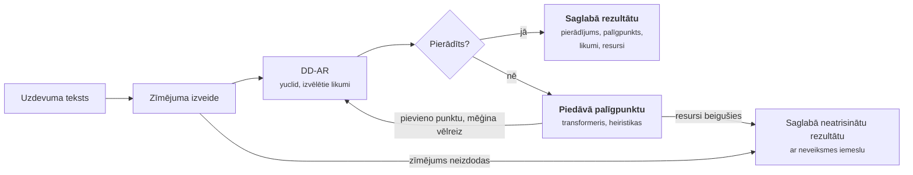
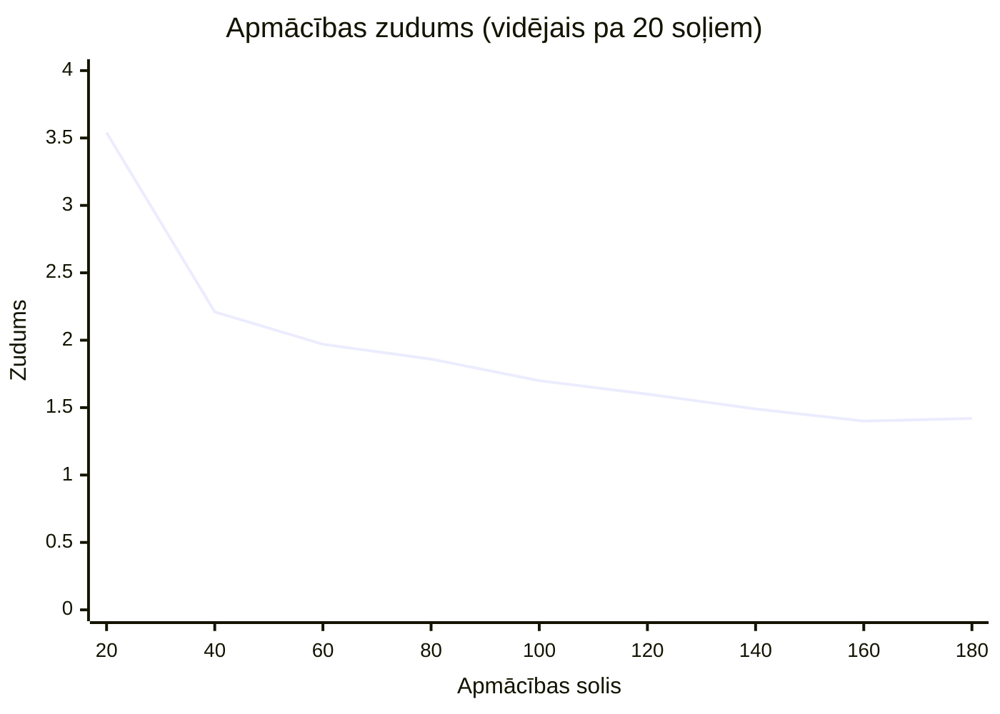

# ZPD ģeometrijas risinātājs: rezultāti

Stāvoklis uz 2026. gada 29. oktobri.

## Pārskats

DD-AR dzinējs yuclid pierāda 60 no 74 Newclid piemēru uzdevumiem, bet Python
dzinējs tikai 37. Pilnais konveijers atrisina 4 no 5 parauga uzdevumiem, katru
aptuveni 2 s laikā. Piektais uzdevums ir apzināti nepareizs tulkojums, un tas
tiek pareizi noraidīts.

Skeneris meklē olimpiāžu ģeometrijas uzdevumus, kuriem ir viegls risinājums
vienā izvēlētā jomā: ar fiksētu likumu kopu, ne vairāk kā vienu palīgpunktu un
nelieliem laika un atmiņas resursiem. DD-AR pierāda, ko var; kad tas apstājas,
palīgpunktus piedāvā transformeris vai vienkāršas heiristikas. Visi skaitļi
šajā dokumentā ņemti no repozitorija failiem: `ddar/results/`,
`results/examples/` un `geo-lm/runs/`.

## Konveijers

DD-AR pierāda, ko var; piedāvāts palīgpunkts dod tam vēl vienu iespēju. Viss
`solve()` izsaukums notiek viena laika un atmiņas budžeta ietvaros. Noklusētā
konfigurācija (`pipeline/configs/default.json`) atļauj 2 palīgpunktu līmeņus
un 80 DD-AR izsaukumus; uzraugs aptur darbu, kad beidzas laiks vai atmiņa.

## Rezultāti

### Deduktīvais dzinējs

yuclid pierāda 60 no 74 Newclid piemēriem, Python dzinējs pierāda 37. Abi
dzinēji risināja tos pašus 74 uzdevumus ar noklusētajiem likumiem, sēkla 0.

| Dzinējs | Pierādīts | Nav pierādīts | Kļūda | Kopā |
| --- | --- | --- | --- | --- |
| yuclid (C++) | **60** | 7 | 7 | 60/74 |
| Python | **37** | 0 | 37 | 37/74 |

Avots: `ddar/results/examples_yuclid.txt` un `examples_python.txt`.

Lielākā daļa Python dzinēja kļūdu (28 no 37) ir viena un tā pati avārija
(`cannot unpack non-iterable Symbol object`), tāpēc tā atpalicība ir kļūda
kodā, nevis vājāks pierādītājs.

### Parauga uzdevumi caur `solve()`

Katrs uzdevums tika palaists ar trim konfigurācijām un budžetu 60 s, 2 GB.
`heuristics_only` rezultāti sakrita ar `ddar_only` 0,2 s robežās, tāpēc tabulā
tie nav parādīti.

| Uzdevums | Atrisināts | Likumi pierādījumā | Laiks, tikai DD-AR (s) | Laiks, ar modeli (s) | Maks. atmiņa, tikai DD-AR (MB) | Maks. atmiņa, ar modeli (MB) |
| --- | --- | --- | --- | --- | --- | --- |
| Varinjona teorēma | jā | 24 | 2,24 | 4,31 | 180 | 536 |
| Pieskares un hordas leņķis | jā | 9 | 2,19 | 4,17 | 178 | 536 |
| Ortocentra atspoguļojums | jā | 8 | 2,03 | 4,22 | 178 | 536 |
| Taisnleņķa trijstūra mediāna | jā | 1 | 2,15 | 4,36 | 178 | 536 |
| Nepareizs tulkojums | nē, zīmējums noraidīts | 0 | 2,19 | 4,26 | 176 | 536 |

Avots: `results/examples/*.json`. Visi atrisinātie pierādījumi ir ar dziļumu 0:
palīgpunkts nevienam nebija vajadzīgs.

### Transformera apmācība

Apmācības zudums samazinājās no 3,54 līdz 1,42, bet precīzā sakritība joprojām
ir 0%. Modelis: transformeris ar 11,2 milj. parametru, 98 000 GenesisGeo
piemēru, 200 soļi uz CPU.

Validācija pie 100. soļa: zudums 1,67, precīzā sakritība 0%. Avots:
`geo-lm/runs/quick/log.jsonl`.

Šis ātrais palaidiens ir tikai pārbaude, nevis apmācīts modelis. Pilnā
`train_small` konfigurācija vēl nav palaista.

## Secinājumi un nākamie soļi

- **Par noklusēto dzinēju izmantot yuclid.** Tas atrisina par 23 piemēriem
  vairāk nekā Python dzinējs. Tā 7 kļūdas ir neatbalstīti apgalvojumi
  (`npara`, `ncoll`, `acompute`) un 4 uzdevumi, kuriem neizdevās izveidot
  zīmējumu.
- **Palīgpunktu rīki vēl nav pārbaudīti tur, kur tie ir svarīgi.** Visi 4
  atrisinātie piemēri tika pierādīti tikai ar DD-AR dziļumā 0, tāpēc ne
  transformerim, ne heiristikām nebija jāpiedāvā neviens punkts.
- **Transformeris vēl nav noderīgs.** Pēc 200 soļiem uz CPU tā precīzā
  sakritība ir 0%, un tā ielāde divkāršo risināšanas laiku un trīskāršo
  atmiņas patēriņu.

Nākamie soļi:

- [ ] Pievienot mapē `problems/` uzdevumus, kuriem vajag tieši vienu palīgpunktu
- [ ] Pilnībā apmācīt `train_small` uz GPU un vēlreiz pārbaudīt precīzo sakritību
- [ ] Palaist saglabātos piemērus ar apmācīto modeli un salīdzināt ar `heuristics_only`
