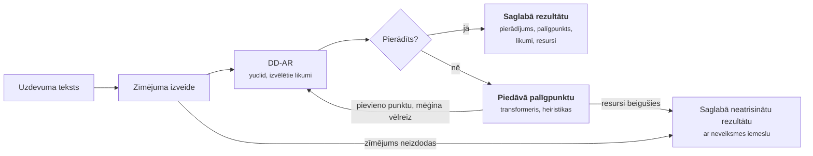
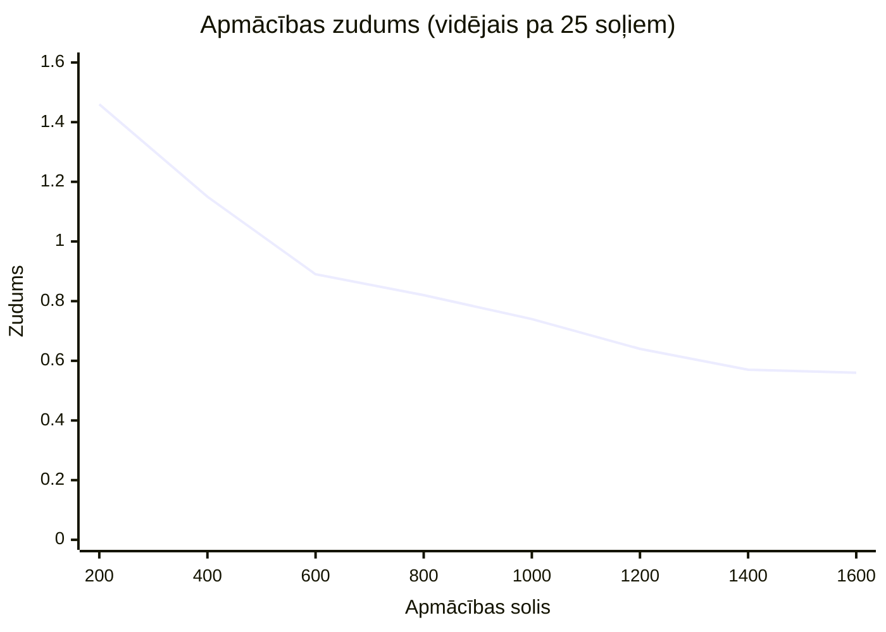

# ZPD ģeometrijas risinātājs: rezultāti

Stāvoklis uz 2026. gada 9. novembri.

## Pārskats

Pēc 14 minūšu apmācības uz CPU mazais transformeris (2,1 milj. parametru)
atrisina abus JGEX uzdevumus, kuros DD-AR iestrēgst, ar vienu palīgpunktu
katrā (apmēram 8 s). Heiristikas tos atrisina ātrāk (apmēram 3 s), bet
vienam uzdevumam tām vajag divus palīgpunktus. Uz 200 neredzētiem GenesisGeo
uzdevumiem 92% modeļa piedāvājumu ir pārvēršami Newclid konstrukcijās, un 21%
gadījumu viens no 4 piedāvājumiem precīzi sakrīt ar atsauces palīgpunktu.
Ilgāk apmācīts tas pats modelis (`mini_long`, 3000 soļi) šos rādītājus
uzlabo līdz 94% un 32%.
Pilnais konveijers atrisina 4 no 5 parauga uzdevumiem, katru aptuveni 2 s
laikā; piektais ir apzināti nepareizs tulkojums, un tas tiek pareizi noraidīts.

Skeneris meklē olimpiāžu ģeometrijas uzdevumus, kuriem ir viegls risinājums
vienā izvēlētā jomā: ar fiksētu likumu kopu, ne vairāk kā vienu palīgpunktu un
nelieliem laika un atmiņas resursiem. DD-AR pierāda, ko var; kad tas apstājas,
palīgpunktus piedāvā transformeris vai vienkāršas heiristikas. Visi skaitļi
šajā dokumentā ņemti no repozitorija failiem: `results/jgex_ag_231/`,
`results/examples/`, `results/transformer/` un `geo-lm/runs/`.

## Konveijers

DD-AR pierāda, ko var; piedāvāts palīgpunkts dod tam vēl vienu iespēju. Viss
`solve()` izsaukums notiek viena laika un atmiņas budžeta ietvaros. Noklusētā
konfigurācija (`pipeline/configs/default.json`) atļauj 2 palīgpunktu līmeņus
un 80 DD-AR izsaukumus; uzraugs aptur darbu, kad beidzas laiks vai atmiņa.

## Rezultāti

### Ar LLM un bez tā

Salīdzinātas konfigurācijas uz pirmajiem 73 no 231 JGEX uzdevuma
(`jgex_ag_231` no Newclid). Pilns skrējiens tika apturēts laika dēļ.

1. Tikai DD-AR (`ddar_only`) uz visiem 73 uzdevumiem, budžets 30 s.
2. Uz tiem 2 uzdevumiem, kur DD-AR iestrēga: DD-AR + heiristikas
   (`heuristics_only`, 15 s), DD-AR + vecais 200 soļu modelis un heiristikas
   (`quick_model`, 15 s) un DD-AR + jaunais modelis bez heiristikām
   (`mini_model`, 60 s).

**Tikai DD-AR:** atrisināti 71 no 73 (97%), mediāna 1,9 s, 180 MB un 17 likumu
pielietojumi pierādījumā. Palīgpunkts nevienam no tiem nebija vajadzīgs.

**Uzdevumi, kur DD-AR iestrēga:**

| Uzdevums | Tikai DD-AR | DD-AR + heiristikas | DD-AR + vecais modelis (200 soļi) | DD-AR + jaunais modelis (1600 soļi) |
| --- | --- | --- | --- | --- |
| `L053-1` | nē, iestrēga | **jā**, 3,3 s, 1 palīgpunkts (`foot`), 5 DD-AR izsaukumi | nē, 15 s limits | **jā**, 8,3 s, 1 palīgpunkts (viduspunkts), 5 DD-AR izsaukumi |
| `L058-9` | nē, iestrēga | **jā**, 2,8 s, 2 palīgpunkti (`circle`, `circle`), 19 DD-AR izsaukumi | nē, 15 s limits | **jā**, 8,6 s, 1 palīgpunkts (viduspunkts), 2 DD-AR izsaukumi |

Jaunais modelis abos uzdevumos atrada palīgpunktu ar pirmo piedāvājumu, tātad
abi risinājumi atbilst "vieglā risinājuma" definīcijai (viens palīgpunkts).
Ar heiristikām tā ir tikai `L053-1`. Modeļa piedāvājums `L058-9` ir hordas
`ab` viduspunkts (`f : coll a b f, cong a f b f`), un ar to pierādījumā
pietiek ar 8 likumu pielietojumiem. Modelis ir lēnāks: apmēram 5 s aiziet
uz tā ielādi un staru meklēšanu, un atmiņas patēriņš ir 410 MB pret 180 MB.

Divi uzdevumi ir pārāk maz secinājumiem; tas rāda, ka modelis strādā, bet
neļauj teikt, ka tas ir labāks par heiristikām.

Avots: `results/jgex_ag_231/*.jsonl`, skripts `bench/sweep.py`, konfigurācija
`pipeline/configs/mini_model.json`.

### Parauga uzdevumi caur `solve()`

Katrs uzdevums tika palaists ar trim konfigurācijām un budžetu 60 s, 2 GB.
`heuristics_only` rezultāti sakrita ar `ddar_only` 0,2 s robežās, tāpēc tabulā
tie nav parādīti.

| Uzdevums | Atrisināts | Likumi pierādījumā | Laiks, tikai DD-AR (s) | Laiks, ar modeli (s) | Maks. atmiņa, tikai DD-AR (MB) | Maks. atmiņa, ar modeli (MB) |
| --- | --- | --- | --- | --- | --- | --- |
| Varinjona teorēma | jā | 24 | 2,24 | 4,31 | 180 | 536 |
| Pieskares un hordas leņķis | jā | 9 | 2,19 | 4,17 | 178 | 536 |
| Ortocentra atspoguļojums | jā | 8 | 2,03 | 4,22 | 178 | 536 |
| Taisnleņķa trijstūra mediāna | jā | 1 | 2,15 | 4,36 | 178 | 536 |
| Nepareizs tulkojums | nē, zīmējums noraidīts | 0 | 2,19 | 4,26 | 176 | 536 |

Avots: `results/examples/*.json`. Visi atrisinātie pierādījumi ir ar dziļumu 0:
palīgpunkts nevienam nebija vajadzīgs.

### Transformera apmācība

Modelis: transformeris ar 2,1 milj. parametru (4 slāņi, 4 galvas, 192
dimensijas; `geo-lm/configs/model_mini.json`), 98 008 GenesisGeo piemēri,
1600 soļi pa 32 piemēriem (apmēram puse epohas), 14 minūtes uz 2 CPU kodoliem.
Lielais modelis (11 milj. parametru) 20 minūtēs paspētu tikai apmēram 550
soļus, tāpēc īsai apmācībai izvēlēts mazāks.

| Solis | Validācijas zudums | Precīzā sakritība (100 uzdevumi, alkatīgā dekodēšana) |
| --- | --- | --- |
| 400 | 1,17 | 0% |
| 800 | 0,85 | 2% |
| 1200 | 0,66 | 8% |
| 1600 | 0,57 | 6% |

Zudums vēl krītas, tātad ilgāka apmācība (pilnā, apmēram 14 h) vēl uzlabotu
modeli. Iepriekšējais 200 soļu skrējiens ar lielo modeli sasniedza
validācijas zudumu 1,67 un 0% sakritību. Avots: `geo-lm/runs/mini/log.jsonl`.

**Ilgāks skrējiens (`mini_long`).** Tas pats modelis, plānoti 9000 soļi
(apmēram 3 epohas, `geo-lm/configs/train_mini_long.json`). Codespace pēc
30 minūtēm bez lietotāja ievades apstājās, tāpēc skrējiens beidzās pie
3200. soļa; labākais kontrolpunkts ir no 3000. soļa.

| Solis | Validācijas zudums | Precīzā sakritība |
| --- | --- | --- |
| 1500 | 0,76 | 3% |
| 3000 | 0,49 | 11% |

Zudums joprojām krītas. Avots: `results/transformer/mini_long_train_log.jsonl`;
kontrolpunkti `geo-lm/runs/mini/` un `geo-lm/runs/mini_long/` ir gitā, tāpēc
`mini_long` skrējienu var turpināt no `last.pt` ar to pašu konfigurāciju.

### Modeļa piedāvājumu pārbaude

200 neredzēti GenesisGeo uzdevumi, staru meklēšana ar 4 hipotēzēm, 50 s uz CPU
(skripts `geo-lm/scripts/eval_aux.py`):

| Rādītājs | `mini` (1600 soļi) | `mini_long` (3000 soļi) |
| --- | --- | --- |
| Pabeigtas hipotēzes (ar `<eos>`) | 100% | 100% |
| Hipotēzes, kas pārvēršamas Newclid konstrukcijās | 91,6% | 94,3% |
| Uzdevumi ar vismaz vienu pārvēršamu piedāvājumu | 96% | 98% |
| Pirmais piedāvājums precīzi sakrīt ar atsauci | 6% | 11,5% |
| Kāds no 4 piedāvājumiem precīzi sakrīt ar atsauci | 21% | 32% |

`mini` noraidīto 67 hipotēžu iemesli: atsauce uz neesošu punktu (35), predikāts
bez Newclid konstrukcijas, piemēram `eqangle` (25), pārējie (7). `mini_long`
noraidīja 46: neesošs punkts (36), nav konstrukcijas (7), pārējie (3); tātad
ilgāka apmācība gandrīz novērš predikātus bez konstrukcijas. Precīza sakritība
ir stingrs mērs: arī atšķirīgs palīgpunkts var derēt, kā rāda `L058-9`.
Avoti: `results/transformer/eval_mini_val200.json`,
`results/transformer/eval_mini_long_val200.json`.

## Secinājumi un nākamie soļi

- **Heiristikas strādā un ir ātras.** Abos uzdevumos, kur DD-AR iestrēga, tās
  atrada palīgpunktus mazāk nekā 4 s laikā.
- **Arī īsi apmācīts LLM jau palīdz.** Pēc 14 minūtēm uz CPU tā piedāvājumi
  gandrīz vienmēr ir derīgas konstrukcijas, un abos iestrēgušajos uzdevumos
  tas atrada vienu palīgpunktu, kas noved pie pierādījuma; `L058-9` tas deva
  vieglāku risinājumu nekā heiristikas.
- **Cena ir laiks un atmiņa.** Ar modeli risināšana ilgst apmēram 8 s, nevis
  3 s, un prasa 410 MB, nevis 180 MB; 60 s un 2 GB budžetā tas iekļaujas.
- **Salīdzinājums ir mazs.** Tikai 2 iestrēguši uzdevumi; ticamam
  secinājumam vajag visus 231 JGEX uzdevumus un Latvijas olimpiāžu uzdevumus.

Nākamie soļi:

- [ ] Pilnā apmācība (8.1, apmēram 14 h), jo zudums vēl krītas; tā neiekļaujas 2-4 h Codespace dīkstāves
      limitā, tāpēc vai nu vairākās sesijās ar `last.pt`, vai Kaggle
- [ ] `mini_long` uz abiem iestrēgušajiem JGEX uzdevumiem (palaišana tika pārtraukta)
- [ ] Pabeigt `bench/sweep.py` skrējienu uz visiem 231 JGEX uzdevumiem ar
      `heuristics_only` un `mini_model`
- [ ] Jomu konfigurācijas ar transformeri (`pipeline/configs/domains_transformer/`)
      palaist uz parauga un izmēģinājuma uzdevumiem (8.3)
- [ ] Pievienot mapē `problems/` uzdevumus, kuriem vajag tieši vienu palīgpunktu
