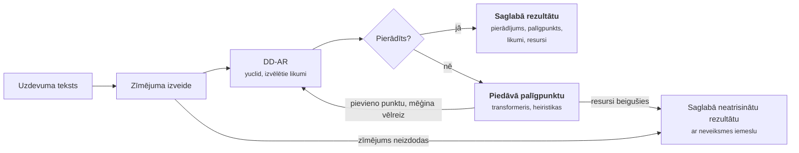
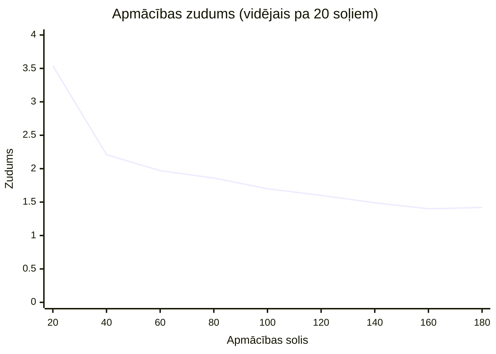

# ZPD ģeometrijas risinātājs: rezultāti

Stāvoklis uz 2026. gada 29. oktobri.

## Pārskats

Kad DD-AR iestrēgst, palīgpunkti no heiristikām atrisina abus pārbaudītos
uzdevumus aptuveni 3 s laikā, bet ar LLM (transformeri) neviens netiek
atrisināts 15 s laikā. Pilnais konveijers atrisina 4 no 5 parauga uzdevumiem,
katru aptuveni 2 s laikā; piektais ir apzināti nepareizs tulkojums, un tas tiek
pareizi noraidīts.

Skeneris meklē olimpiāžu ģeometrijas uzdevumus, kuriem ir viegls risinājums
vienā izvēlētā jomā: ar fiksētu likumu kopu, ne vairāk kā vienu palīgpunktu un
nelieliem laika un atmiņas resursiem. DD-AR pierāda, ko var; kad tas apstājas,
palīgpunktus piedāvā transformeris vai vienkāršas heiristikas. Visi skaitļi
šajā dokumentā ņemti no repozitorija failiem: `results/jgex_ag_231/`,
`results/examples/` un `geo-lm/runs/`.

## Konveijers

DD-AR pierāda, ko var; piedāvāts palīgpunkts dod tam vēl vienu iespēju. Viss
`solve()` izsaukums notiek viena laika un atmiņas budžeta ietvaros. Noklusētā
konfigurācija (`pipeline/configs/default.json`) atļauj 2 palīgpunktu līmeņus
un 80 DD-AR izsaukumus; uzraugs aptur darbu, kad beidzas laiks vai atmiņa.

## Rezultāti

### Ar LLM un bez tā

Salīdzinātas trīs konfigurācijas uz pirmajiem 73 no 231 JGEX uzdevuma
(`jgex_ag_231` no Newclid). Pilns skrējiens tika apturēts laika dēļ.

1. Tikai DD-AR (`ddar_only`) uz visiem 73 uzdevumiem, budžets 30 s.
2. Uz tiem 2 uzdevumiem, kur DD-AR iestrēga: DD-AR + heiristikas
   (`heuristics_only`) un DD-AR + LLM + heiristikas (`quick_model`), budžets 15 s.

**Tikai DD-AR:** atrisināti 71 no 73 (97%), mediāna 1,9 s, 180 MB un 17 likumu
pielietojumi pierādījumā. Palīgpunkts nevienam no tiem nebija vajadzīgs.

**Uzdevumi, kur DD-AR iestrēga:**

| Uzdevums | Tikai DD-AR | DD-AR + heiristikas | DD-AR + LLM |
| --- | --- | --- | --- |
| `L053-1` | nē, iestrēga | **jā**, 3,3 s, 1 palīgpunkts (`foot`), 5 DD-AR izsaukumi | nē, 15 s limits |
| `L058-9` | nē, iestrēga | **jā**, 2,8 s, 2 palīgpunkti (`circle`, `circle`), 19 DD-AR izsaukumi | nē, 15 s limits |

Ar heiristikām `L053-1` atbilst "vieglā risinājuma" definīcijai (viens
palīgpunkts), bet `L058-9` prasa divus. LLM konfigurācija abos gadījumos
iztērēja visu laiku, pirms tika līdz pierādījumam: modeļa ielāde un staru
meklēšana (beam search) uz CPU ir lēna, un tā darbojās paralēli heiristiku
skrējienam uz tiem pašiem 2 CPU kodoliem. Ar ilgāku budžetu rezultāts var
mainīties, bet šis modelis vēl nav apmācīts (skat. zemāk).

Avots: `results/jgex_ag_231/*.jsonl`, skripts `bench/sweep.py`.

### Parauga uzdevumi caur `solve()`

Katrs uzdevums tika palaists ar trim konfigurācijām un budžetu 60 s, 2 GB.
`heuristics_only` rezultāti sakrita ar `ddar_only` 0,2 s robežās, tāpēc tabulā
tie nav parādīti.

| Uzdevums | Atrisināts | Likumi pierādījumā | Laiks, tikai DD-AR (s) | Laiks, ar modeli (s) | Maks. atmiņa, tikai DD-AR (MB) | Maks. atmiņa, ar modeli (MB) |
| --- | --- | --- | --- | --- | --- | --- |
| Varinjona teorēma | jā | 24 | 2,24 | 4,31 | 180 | 536 |
| Pieskares un hordas leņķis | jā | 9 | 2,19 | 4,17 | 178 | 536 |
| Ortocentra atspoguļojums | jā | 8 | 2,03 | 4,22 | 178 | 536 |
| Taisnleņķa trijstūra mediāna | jā | 1 | 2,15 | 4,36 | 178 | 536 |
| Nepareizs tulkojums | nē, zīmējums noraidīts | 0 | 2,19 | 4,26 | 176 | 536 |

Avots: `results/examples/*.json`. Visi atrisinātie pierādījumi ir ar dziļumu 0:
palīgpunkts nevienam nebija vajadzīgs.

### Transformera apmācība

Apmācības zudums samazinājās no 3,54 līdz 1,42, bet precīzā sakritība joprojām
ir 0%. Modelis: transformeris ar 11,2 milj. parametru, 98 000 GenesisGeo
piemēru, 200 soļi uz CPU.

Validācija pie 100. soļa: zudums 1,67, precīzā sakritība 0%. Avots:
`geo-lm/runs/quick/log.jsonl`.

Šis ātrais palaidiens ir tikai pārbaude, nevis apmācīts modelis. Pilnā
`train_small` konfigurācija vēl nav palaista.

## Secinājumi un nākamie soļi

- **Heiristikas jau strādā.** Abos uzdevumos, kur DD-AR iestrēga, tās atrada
  palīgpunktus, kas noveda pie pierādījuma, mazāk nekā 4 s laikā.
- **LLM vēl nepalīdz.** Pēc 200 soļiem uz CPU tā precīzā sakritība ir 0%,
  tā ielāde divkāršo risināšanas laiku un trīskāršo atmiņas patēriņu, un
  15 s budžetā tas neatrisināja nevienu iestrēgušo uzdevumu.
- **Salīdzinājums ir mazs.** Tikai 2 iestrēguši uzdevumi; ticamam
  secinājumam vajag visus 231 JGEX uzdevumus un apmācītu modeli.

Nākamie soļi:

- [ ] Pabeigt `bench/sweep.py` skrējienu uz visiem 231 JGEX uzdevumiem
- [ ] Pievienot mapē `problems/` uzdevumus, kuriem vajag tieši vienu palīgpunktu
- [ ] Pilnībā apmācīt `train_small` uz GPU un vēlreiz pārbaudīt precīzo sakritību
- [ ] Palaist saglabātos piemērus ar apmācīto modeli un salīdzināt ar `heuristics_only`
