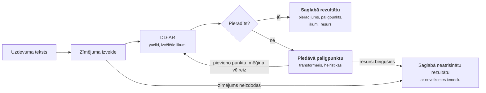
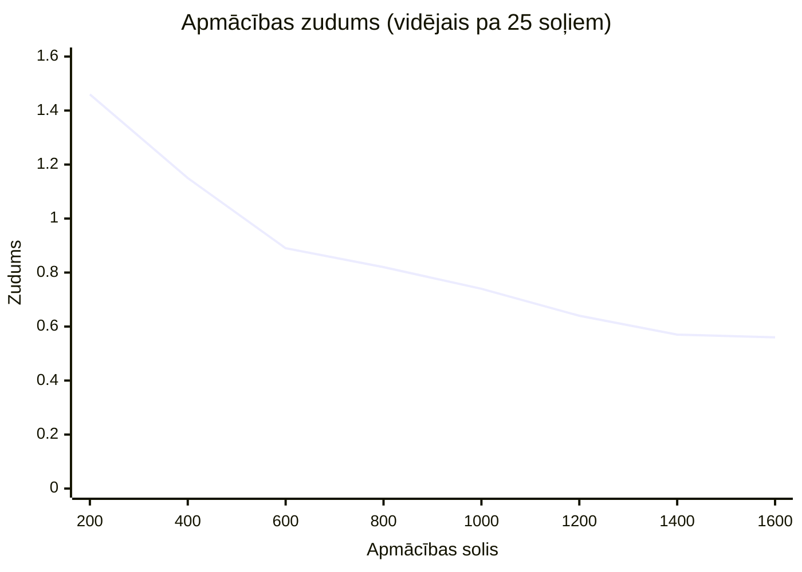

# ZPD ģeometrijas risinātājs: rezultāti

Stāvoklis uz 2026. gada 10. novembri.

## Pārskats

Pēc 14 minūšu apmācības uz CPU mazais transformeris (2,1 milj. parametru)
atrisina abus JGEX uzdevumus, kuros DD-AR iestrēgst, ar vienu palīgpunktu
katrā (apmēram 8 s). Heiristikas tos atrisina ātrāk (apmēram 3 s), bet
vienam uzdevumam tām vajag divus palīgpunktus. Uz 200 neredzētiem GenesisGeo
uzdevumiem 92% modeļa piedāvājumu ir pārvēršami Newclid konstrukcijās, un 21%
gadījumu viens no 4 piedāvājumiem precīzi sakrīt ar atsauces palīgpunktu.
Ilgāk apmācīts tas pats modelis (`mini_long`, 9000 soļi, apmēram 1,5 h)
precīzo sakritību uzlabo līdz 33% ar pirmo un 49,5% ar kādu no 4
piedāvājumiem; no abiem iestrēgušajiem JGEX uzdevumiem tas atrisina vienu.
Uz visām standarta kopām (60 s, 2 GB, 2 CPU kodoli): tikai DD-AR atrisina
205 no 231 JGEX uzdevuma un 15 no 29 IMO-AG-30 uzdevumiem; modelis pievieno
vēl 5 JGEX uzdevumus, 0 IMO-AG-30 uzdevumus un 3 no 101 IMO uzdevuma, kuriem
noteikti vajag palīgpunktu. AlphaGeometry (AG1) atrisina 25 no 30 IMO-AG-30.
Pilnais konveijers atrisina 4 no 5 parauga uzdevumiem, katru aptuveni 2 s
laikā; piektais ir apzināti nepareizs tulkojums, un tas tiek pareizi noraidīts.

Skeneris meklē olimpiāžu ģeometrijas uzdevumus, kuriem ir viegls risinājums
vienā izvēlētā jomā: ar fiksētu likumu kopu, ne vairāk kā vienu palīgpunktu un
nelieliem laika un atmiņas resursiem. DD-AR pierāda, ko var; kad tas apstājas,
palīgpunktus piedāvā transformeris vai vienkāršas heiristikas. Visi skaitļi
šajā dokumentā ņemti no repozitorija failiem: `results/jgex_ag_231/`,
`results/examples/`, `results/transformer/` un `geo-lm/runs/`.

## Konveijers

DD-AR pierāda, ko var; piedāvāts palīgpunkts dod tam vēl vienu iespēju. Viss
`solve()` izsaukums notiek viena laika un atmiņas budžeta ietvaros. Noklusētā
konfigurācija (`pipeline/configs/default.json`) atļauj 2 palīgpunktu līmeņus
un 80 DD-AR izsaukumus; uzraugs aptur darbu, kad beidzas laiks vai atmiņa.

## Rezultāti

### Ar LLM un bez tā

Salīdzinātas konfigurācijas uz pirmajiem 73 no 231 JGEX uzdevuma
(`jgex_ag_231` no Newclid). Pilns skrējiens tika apturēts laika dēļ; visu
231 uzdevumu rezultāti ir sadaļā "Standarta kopas" zemāk.

1. Tikai DD-AR (`ddar_only`) uz visiem 73 uzdevumiem, budžets 30 s.
2. Uz tiem 2 uzdevumiem, kur DD-AR iestrēga: DD-AR + heiristikas
   (`heuristics_only`, 15 s), DD-AR + vecais 200 soļu modelis un heiristikas
   (`quick_model`, 15 s) un DD-AR + jaunais modelis bez heiristikām
   (`mini_model`, 60 s).

**Tikai DD-AR:** atrisināti 71 no 73 (97%), mediāna 1,9 s, 180 MB un 17 likumu
pielietojumi pierādījumā. Palīgpunkts nevienam no tiem nebija vajadzīgs.

**Uzdevumi, kur DD-AR iestrēga:**

| Uzdevums | Tikai DD-AR | DD-AR + heiristikas | DD-AR + vecais modelis (200 soļi) | DD-AR + jaunais modelis (1600 soļi) |
| --- | --- | --- | --- | --- |
| `L053-1` | nē, iestrēga | **jā**, 3,3 s, 1 palīgpunkts (`foot`), 5 DD-AR izsaukumi | nē, 15 s limits | **jā**, 8,3 s, 1 palīgpunkts (viduspunkts), 5 DD-AR izsaukumi |
| `L058-9` | nē, iestrēga | **jā**, 2,8 s, 2 palīgpunkti (`circle`, `circle`), 19 DD-AR izsaukumi | nē, 15 s limits | **jā**, 8,6 s, 1 palīgpunkts (viduspunkts), 2 DD-AR izsaukumi |

Jaunais modelis abos uzdevumos atrada palīgpunktu ar pirmo piedāvājumu, tātad
abi risinājumi atbilst "vieglā risinājuma" definīcijai (viens palīgpunkts).
Ar heiristikām tā ir tikai `L053-1`. Modeļa piedāvājums `L058-9` ir hordas
`ab` viduspunkts (`f : coll a b f, cong a f b f`), un ar to pierādījumā
pietiek ar 8 likumu pielietojumiem. Modelis ir lēnāks: apmēram 5 s aiziet
uz tā ielādi un staru meklēšanu, un atmiņas patēriņš ir 410 MB pret 180 MB.

Divi uzdevumi ir pārāk maz secinājumiem; tas rāda, ka modelis strādā, bet
neļauj teikt, ka tas ir labāks par heiristikām.

Avots: `results/jgex_ag_231/*.jsonl`, skripts `bench/sweep.py`, konfigurācija
`pipeline/configs/mini_model.json`.

### Standarta kopas: JGEX-231 un IMO, salīdzinājums ar AG1

Divas konfigurācijas uz trim Newclid kopām
(`third_party/Newclid/newclid/problems_datasets/`), budžets 60 s un 2 GB uz
uzdevumu, 2 CPU kodoli:

1. Tikai DD-AR (`ddar_only`) uz visiem uzdevumiem.
2. DD-AR + `mini_long` (9000 soļi, `mini_long_model.json`: līdz 2 palīgpunktu
   līmeņiem, 80 DD-AR izsaukumi) tikai uz tiem uzdevumiem, ko DD-AR viens
   neatrisināja. Ja DD-AR uzdevumu atrisina, otrā konfigurācija dod to pašu
   rezultātu (tā vispirms palaiž DD-AR), tāpēc to atkārtoti nepalaida.

Kopas: `jgex_ag_231` (231 vieglāks uzdevums no AG1 raksta), `imo` (34 IMO
uzdevumi, no tiem 29 no AG1 etalona IMO-AG-30; trūkst `2000_p1`) un
`imo_102_requires_aux` (101 IMO un IMO shortlist uzdevums, ko Newclid DD-AR
viens neatrisina; kopa veidota palīgpunktu modeļu pārbaudei). Viss skrējiens
ilga 23 minūtes.

| Kopa | Uzdevumi | Tikai DD-AR | + `mini_long` | Kopā | AG1: DD+AR | AG1: AlphaGeometry |
| --- | --- | --- | --- | --- | --- | --- |
| JGEX-AG-231 | 231 | 205 (89%) | +5 no 26 | **210 (91%)** | 198 | 228 |
| IMO-AG-30 (29 no 30) | 29 | 15 | +0 no 14 | **15** | 14 | 25 |
| `imo` pārējie (1975_p3, 1983_p2, 1995_p1, 2024_p4, 2025_p2) | 5 | 2 | +0 no 3 | 2 | – | – |
| `imo_102_requires_aux` | 101 | 0 | +3 no 101 | **3** | – | – |

AG1 skaitļi ņemti no Trinh et al., *Nature* 625 (2024): IMO-AG-30 tabulā arī
DD+AR ar cilvēku heiristikām 18. AG1 izmantoja simtiem reižu lielāku modeli un
daudz plašāku meklēšanu uz jaudīgas aparatūras; šeit ir 2,1 milj. parametru
modelis un 60 s uz 2 CPU kodoliem. Pirms citēšanas darbā JGEX skaitļi (198, 228)
jāpārbauda pēc raksta tabulas.

**Ko tas rāda.**

- **Newclid DD-AR ir spēcīgāks par AG1 DD+AR**: 205 pret 198 uz JGEX un 15
  pret 14 uz IMO-AG-30 (pat bez `2000_p1`). Tā mediāna ir 1,8 s; lēnākais
  JGEX uzdevums 27 s, lēnākais IMO uzdevums 3 s. Daļa IMO formulējumu Newclid
  kopā jau satur cilvēku ieteiktus palīgpunktus (piem., `2008_p1b`), tāpēc
  salīdzinājums nav pilnīgi godīgs.
- **Modelis palīdz maz, bet palīdz.** Tas atrisina 5 no 26 JGEX uzdevumiem un
  3 no 101 IMO uzdevumiem, kur DD-AR iestrēgst, katru apmēram 4-5 s. Uz
  IMO-AG-30 tas nepievieno neko; AG1 modelis pievieno 11.
- **"Viegls risinājums" (viens palīgpunkts)** ir tikai daļai: JGEX `L058-9`
  un `E061-61`, IMO `imo_sl_2015_g3_variant` un `imo_sl_2016_g4`. Pārējiem
  četriem vajadzēja divus palīgpunktus. Gandrīz visi modeļa palīgpunkti ir
  nogriežņa viduspunkti.
- **Kāpēc ne vairāk:** no 101 IMO uzdevuma 61 meklēšana izsmēla 2 līmeņus bez
  pierādījuma un 36 modelis nedeva nevienu derīgu konstrukciju. Laika limits
  netika sasniegts nevienam uzdevumam (mediāna 6,7 s), tātad ierobežo modeļa
  piedāvājumu kvalitāte, nevis laiks.
- `L053-1` arī šoreiz netika atrisināts (1600 soļu modelis to atrisināja).
- Divus uzdevumus Newclid nevar uzbūvēt (`yuclid` kļūda vienam JGEX,
  `ValueError` vienam IMO); tie skaitīti kā neatrisināti.

Avoti: `results/jgex_ag_231/`, `results/imo/`, `results/imo_102_requires_aux/`
(`ddar_only.jsonl`, `ddar_unsolved.txt`, `mini_long_model.jsonl`), skripts
`bench/run_benchmarks.sh`. Pirmie 73 JGEX `ddar_only` rezultāti ir no
agrāka skrējiena ar 30 s budžetu; neviens no tiem nepārsniedza 27 s.

### Parauga uzdevumi caur `solve()`

Katrs uzdevums tika palaists ar trim konfigurācijām un budžetu 60 s, 2 GB.
`heuristics_only` rezultāti sakrita ar `ddar_only` 0,2 s robežās, tāpēc tabulā
tie nav parādīti.

| Uzdevums | Atrisināts | Likumi pierādījumā | Laiks, tikai DD-AR (s) | Laiks, ar modeli (s) | Maks. atmiņa, tikai DD-AR (MB) | Maks. atmiņa, ar modeli (MB) |
| --- | --- | --- | --- | --- | --- | --- |
| Varinjona teorēma | jā | 24 | 2,24 | 4,31 | 180 | 536 |
| Pieskares un hordas leņķis | jā | 9 | 2,19 | 4,17 | 178 | 536 |
| Ortocentra atspoguļojums | jā | 8 | 2,03 | 4,22 | 178 | 536 |
| Taisnleņķa trijstūra mediāna | jā | 1 | 2,15 | 4,36 | 178 | 536 |
| Nepareizs tulkojums | nē, zīmējums noraidīts | 0 | 2,19 | 4,26 | 176 | 536 |

Avots: `results/examples/*.json`. Visi atrisinātie pierādījumi ir ar dziļumu 0:
palīgpunkts nevienam nebija vajadzīgs.

### Transformera apmācība

Modelis: transformeris ar 2,1 milj. parametru (4 slāņi, 4 galvas, 192
dimensijas; `geo-lm/configs/model_mini.json`), 98 008 GenesisGeo piemēri,
1600 soļi pa 32 piemēriem (apmēram puse epohas), 14 minūtes uz 2 CPU kodoliem.
Lielais modelis (11 milj. parametru) 20 minūtēs paspētu tikai apmēram 550
soļus, tāpēc īsai apmācībai izvēlēts mazāks.

| Solis | Validācijas zudums | Precīzā sakritība (100 uzdevumi, alkatīgā dekodēšana) |
| --- | --- | --- |
| 400 | 1,17 | 0% |
| 800 | 0,85 | 2% |
| 1200 | 0,66 | 8% |
| 1600 | 0,57 | 6% |

Zudums vēl krītas, tātad ilgāka apmācība (pilnā, apmēram 14 h) vēl uzlabotu
modeli. Iepriekšējais 200 soļu skrējiens ar lielo modeli sasniedza
validācijas zudumu 1,67 un 0% sakritību. Avots: `geo-lm/runs/mini/log.jsonl`.

**Ilgāks skrējiens (`mini_long`).** Tas pats modelis, 9000 soļi (apmēram
3 epohas, `geo-lm/configs/train_mini_long.json`), apmācīts trijos posmos
(līdz 3200., 5000. un 9000. solim, katru reizi turpinot no `last.pt`), kopā
apmēram 1,5 h uz 2 CPU kodoliem. Labākais kontrolpunkts ir pēdējais.

| Solis | Validācijas zudums | Precīzā sakritība |
| --- | --- | --- |
| 1500 | 0,76 | 3% |
| 3000 | 0,49 | 11% |
| 4500 | 0,41 | 16% |
| 6000 | 0,34 | 31% |
| 7500 | 0,29 | 32% |
| 9000 | 0,27 | 28% |

Validācijas zudums krītas līdz beigām, bet lēnāk (mācīšanās ātrums
kosinusa grafikā nonāk līdz minimumam). Sakritība uz 100 piemēriem ir
trokšņaina (±5 punkti). Avots: `results/transformer/mini_long_train_log.jsonl`;
kontrolpunkti `geo-lm/runs/mini/` un `geo-lm/runs/mini_long/` ir gitā.

### Modeļa piedāvājumu pārbaude

200 neredzēti GenesisGeo uzdevumi, staru meklēšana ar 4 hipotēzēm, 50 s uz CPU
(skripts `geo-lm/scripts/eval_aux.py`):

| Rādītājs | `mini` (1600 soļi) | `mini_long` (3000 soļi) | `mini_long` (9000 soļi) |
| --- | --- | --- | --- |
| Pabeigtas hipotēzes (ar `<eos>`) | 100% | 100% | 100% |
| Hipotēzes, kas pārvēršamas Newclid konstrukcijās | 91,6% | 94,3% | 90,6% |
| Uzdevumi ar vismaz vienu pārvēršamu piedāvājumu | 96% | 98% | 94,5% |
| Pirmais piedāvājums precīzi sakrīt ar atsauci | 6% | 11,5% | **33%** |
| Kāds no 4 piedāvājumiem precīzi sakrīt ar atsauci | 21% | 32% | **49,5%** |

`mini` noraidīto 67 hipotēžu iemesli: atsauce uz neesošu punktu (35), predikāts
bez Newclid konstrukcijas, piemēram `eqangle` (25), pārējie (7). `mini_long`
noraidīja 46: neesošs punkts (36), nav konstrukcijas (7), pārējie (3); tātad
ilgāka apmācība gandrīz novērš predikātus bez konstrukcijas. Precīza sakritība
ir stingrs mērs: arī atšķirīgs palīgpunkts var derēt, kā rāda `L058-9`.
Avoti: `results/transformer/eval_mini_val200.json`,
`results/transformer/eval_mini_long_val200.json`,
`results/transformer/eval_mini_long_9000_val200.json`.

Pēc 9000 soļiem precīzā sakritība gandrīz trīskāršojas, bet pārvēršamo
hipotēžu daļa nedaudz krīt: no 75 noraidītajām 37 atsaucas uz neesošu punktu
un 33 ir "bez predikātiem" (modelis nosauc punktu, bet neuzraksta tam
nosacījumu). Tātad ilgāk apmācīts modelis biežāk trāpa precīzi, bet pārējos
staros vairāk riskē.

**`mini_long` (9000 soļi) uz iestrēgušajiem JGEX uzdevumiem** (60 s budžets):
`L058-9` atrisināts 3,8 s ar vienu palīgpunktu (hordas `ad` viduspunkts,
17 likumi pierādījumā); `L053-1` nav atrisināts: 21 DD-AR izsaukums un
5 modeļa izsaukumi izsmēla meklēšanu līdz dziļumam 2 (4,8 s), un neviens
piedāvājums nebija derīgs. 1600 soļu modelis atrisināja abus. Labāka
sakritība ar atsauci uz GenesisGeo nenozīmē labāku palīdzību uz cita
avota uzdevumiem; ar 2 uzdevumiem to nevar izmērīt. Avots:
`results/jgex_ag_231/mini_long_model.jsonl`.

## Secinājumi un nākamie soļi

- **Heiristikas strādā un ir ātras.** Abos uzdevumos, kur DD-AR iestrēga, tās
  atrada palīgpunktus mazāk nekā 4 s laikā.
- **Arī īsi apmācīts LLM jau palīdz.** Pēc 14 minūtēm uz CPU tā piedāvājumi
  gandrīz vienmēr ir derīgas konstrukcijas, un abos iestrēgušajos uzdevumos
  tas atrada vienu palīgpunktu, kas noved pie pierādījuma; `L058-9` tas deva
  vieglāku risinājumu nekā heiristikas.
- **Cena ir laiks un atmiņa.** Ar modeli risināšana ilgst apmēram 8 s, nevis
  3 s, un prasa 410 MB, nevis 180 MB; 60 s un 2 GB budžetā tas iekļaujas.
- **Uz standarta kopām modelis palīdz maz.** Tas pievieno 5 JGEX un 3 IMO
  uzdevumus (no 26 un 101 iestrēgušajiem), uz IMO-AG-30 neko; AG1 tur
  sasniedz 25 no 30. Ierobežo modeļa piedāvājumu kvalitāte, nevis laiks.
- **DD-AR viens ir spēcīgs:** 205 no 231 JGEX un 15 no 29 IMO-AG-30, vairāk
  nekā AG1 DD+AR.

Nākamie soļi:

- [ ] Pilnā apmācība (8.1, apmēram 14 h, lielais modelis), jo zudums vēl krītas; tā neiekļaujas 2-4 h Codespace dīkstāves
      limitā, tāpēc vai nu vairākās sesijās ar `last.pt`, vai Kaggle
- [x] `mini_long` uz abiem iestrēgušajiem JGEX uzdevumiem (atrisina 1 no 2)
- [x] Visi 231 JGEX, IMO un `imo_102_requires_aux` ar `ddar_only` un `mini_long`
- [ ] Tas pats ar `heuristics_only` un `mini_model` (1600 soļi), lai salīdzinātu
- [ ] Jomu konfigurācijas ar transformeri (`pipeline/configs/domains_transformer/`)
      palaist uz parauga un izmēģinājuma uzdevumiem (8.3)
- [ ] Pievienot mapē `problems/` uzdevumus, kuriem vajag tieši vienu palīgpunktu
