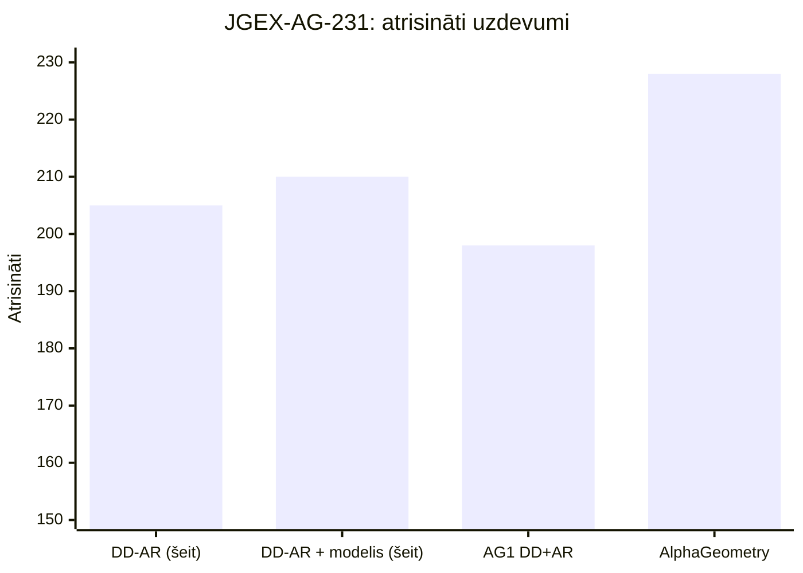
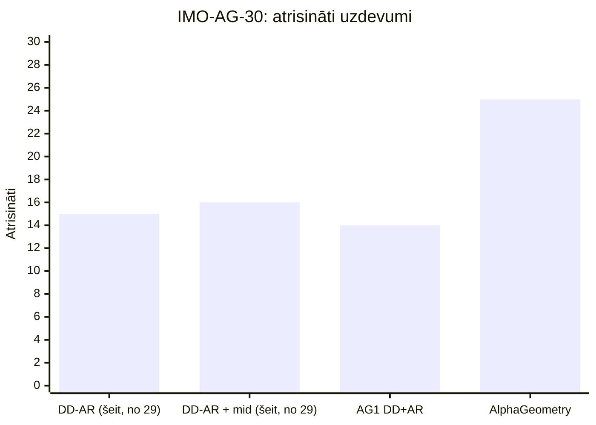
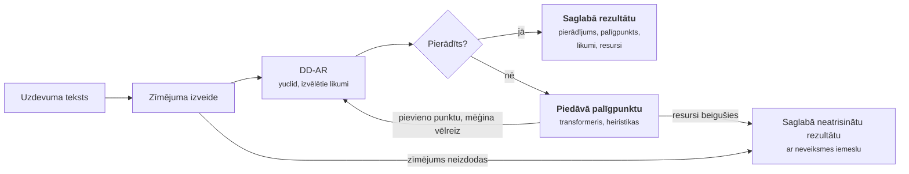
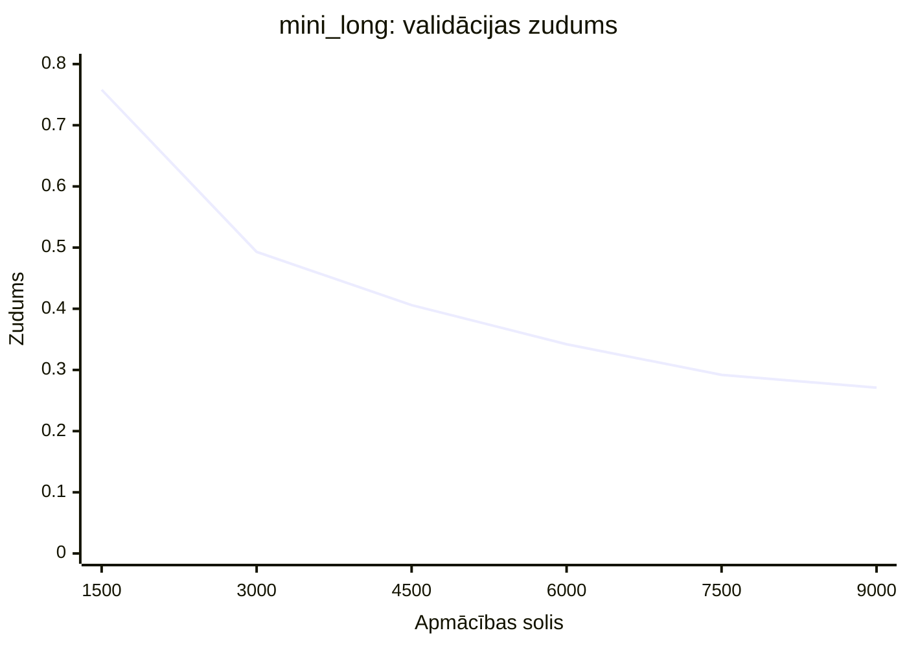
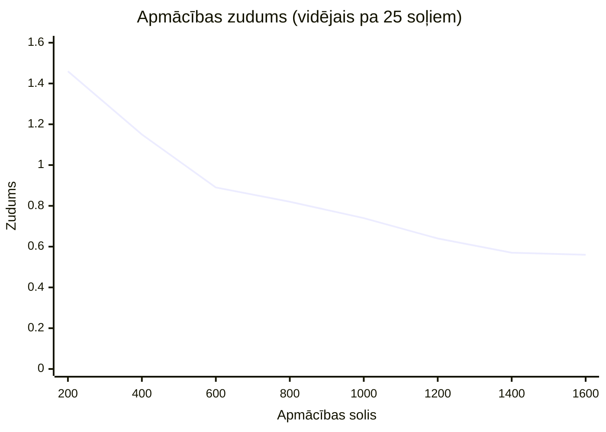

# ZPD ģeometrijas risinātājs: rezultāti

Stāvoklis uz 2026. gada 12. novembri. Visi skaitļi ņemti no repozitorija
failiem (`results/`, `geo-lm/runs/`); avots norādīts katras sadaļas beigās.

## Galvenais īsumā

| | Rezultāts |
| --- | --- |
| **JGEX-AG-231** | DD-AR viens 205 / 231; ar heiristikām un modeļiem kopā **217 / 231 (94%)** (heiristikas +8, `mid` +5, `mini_long` +5); AG1: DD+AR 198, AlphaGeometry 228 |
| **IMO-AG-30** (29 no 30) | DD-AR viens **15**; `mini_long` nepievieno neko, `mid` (9000 soļi) **16** (+2015 P3); AG1: DD+AR 14, AlphaGeometry 25 |
| **IMO, kam vajag palīgpunktu** | `mid` atrisina **6 / 101** (`mini_long` 3; DD-AR viens 0) |
| **Modeļi** | `mid`: 5,1 milj. parametru, 9000 soļi (~3,4 h uz 2 CPU kodoliem), validācijas zudums 0,235; `mini_long`: 2,1 milj., 9000 soļi (~1,5 h), 0,27 |
| **Modeļu salīdzinājums** | uz 200 neredzētiem uzdevumiem `mid` trāpa pirmo palīgpunktu 51,5% (0,7 s); vispārīgi modeļi līdz 1,5 mljrd. parametru 0-2% (13-460 s); GenesisGeo ~53% uz 15 (28 s, var būt redzējis datus); AG1 šeit nedarbojas (atmiņa) |
| **Piedāvājumu kvalitāte** | 200 neredzētos uzdevumos precīzs palīgpunkts ar 1. piedāvājumu: `mid` 39%, `mini_long` 33%; ar kādu no 4: 53,5% un 49,5% |
| **Resursi** | viens uzdevums: mediāna ~2 s ar DD-AR, ~5 s ar modeli; 60 s un 2 GB budžets netika sasniegts |

**Secinājums vienā teikumā:** Newclid DD-AR viens jau pārspēj AG1 DD+AR, un
mazais modelis palīdz tikai dažos uzdevumos; to ierobežo piedāvājumu
kvalitāte, nevis laiks: 2,5 reizes lielāks modelis (`mid`) uzlabo visus
rādītājus nedaudz un pirmo reizi pievieno IMO-AG-30 uzdevumu.

## Ko skeneris dara

Skeneris meklē olimpiāžu ģeometrijas uzdevumus, kuriem ir viegls risinājums
vienā izvēlētā jomā: ar fiksētu likumu kopu, ne vairāk kā vienu palīgpunktu un
nelieliem laika un atmiņas resursiem. DD-AR pierāda, ko var; kad tas apstājas,
palīgpunktus piedāvā transformeris vai vienkāršas heiristikas.

### Konveijers

DD-AR pierāda, ko var; piedāvāts palīgpunkts dod tam vēl vienu iespēju. Viss
`solve()` izsaukums notiek viena laika un atmiņas budžeta ietvaros. Noklusētā
konfigurācija (`pipeline/configs/default.json`) atļauj 2 palīgpunktu līmeņus
un 80 DD-AR izsaukumus; uzraugs aptur darbu, kad beidzas laiks vai atmiņa.

## 1. Standarta kopas: JGEX-231 un IMO, salīdzinājums ar AG1

Divas konfigurācijas uz trim Newclid kopām
(`third_party/Newclid/newclid/problems_datasets/`), budžets 60 s un 2 GB uz
uzdevumu, 2 CPU kodoli:

1. Tikai DD-AR (`ddar_only`) uz visiem uzdevumiem.
2. DD-AR + `mini_long` (9000 soļi, `mini_long_model.json`: līdz 2 palīgpunktu
   līmeņiem, 80 DD-AR izsaukumi) tikai uz tiem uzdevumiem, ko DD-AR viens
   neatrisināja. Ja DD-AR uzdevumu atrisina, otrā konfigurācija dod to pašu
   rezultātu (tā vispirms palaiž DD-AR), tāpēc to atkārtoti nepalaida.

Kopas: `jgex_ag_231` (231 vieglāks uzdevums no AG1 raksta), `imo` (34 IMO
uzdevumi, no tiem 29 no AG1 etalona IMO-AG-30; trūkst `2000_p1`) un
`imo_102_requires_aux` (101 IMO un IMO shortlist uzdevums, ko Newclid DD-AR
viens neatrisina; kopa veidota palīgpunktu modeļu pārbaudei). Viss skrējiens
ilga 23 minūtes.

| Kopa | Uzdevumi | Tikai DD-AR | + heiristikas | + `mini_long` | + `mid` | Kopā (jebkurš avots) | AG1: DD+AR | AG1: AlphaGeometry |
| --- | --- | --- | --- | --- | --- | --- | --- | --- |
| JGEX-AG-231 | 231 | 205 (89%) | +8 no 26 | +5 no 26 | +5 no 26 | **217 (94%)** | 198 | 228 |
| IMO-AG-30 (29 no 30) | 29 | 15 | +0 no 14 | +0 no 14 | +1 no 14 | **16** | 14 | 25 |
| `imo` pārējie (1975_p3, 1983_p2, 1995_p1, 2024_p4, 2025_p2) | 5 | 2 | +0 no 3 | +0 no 3 | +0 no 3 | 2 | – | – |
| `imo_102_requires_aux` | 101 | 0 | nav palaists | +3 no 101 | +6 no 101 | **7** | – | – |

Heiristikas (`heuristics_only`, tie paši meklēšanas iestatījumi) palaistas
2026-11-12. Uz JGEX tās atrisina 8 no 26 (5 ar vienu palīgpunktu), vairāk nekā
katrs modelis, bet citus uzdevumus: kopā ar modeļiem 12 no 26. Uz IMO tās
nepalīdz nevienā (0 no 17); `imo_102` uz tām laika dēļ vēl nav palaists.

`mid` (5,1 milj. parametru, `mid_model.json`, tie paši iestatījumi) palaists
2026-11-12 uz tām pašām DD-AR neveiksmēm; sīkāk 2. sadaļā "Lielāks modelis".

AG1 skaitļi ņemti no Trinh et al., *Nature* 625 (2024): IMO-AG-30 tabulā arī
DD+AR ar cilvēku heiristikām 18. AG1 izmantoja simtiem reižu lielāku modeli un
daudz plašāku meklēšanu uz jaudīgas aparatūras; šeit ir 2,1 milj. parametru
modelis un 60 s uz 2 CPU kodoliem. Skaitļi 198 / 228 (JGEX) un 14 / 25 (IMO-AG-30)
sakrīt ar rezultātu tabulu oficiālajā AG1 repozitorijā
(<https://github.com/google-deepmind/alphageometry>, README); pārbaudīts 2026-11-10.

**Ko tas rāda.**

- **Newclid DD-AR ir spēcīgāks par AG1 DD+AR**: 205 pret 198 uz JGEX un 15
  pret 14 uz IMO-AG-30 (pat bez `2000_p1`). Tā mediāna ir 1,8 s; lēnākais
  JGEX uzdevums 27 s, lēnākais IMO uzdevums 3 s. Daļa IMO formulējumu Newclid
  kopā jau satur cilvēku ieteiktus palīgpunktus (piem., `2008_p1b`), tāpēc
  salīdzinājums nav pilnīgi godīgs.
- **Modelis palīdz maz, bet palīdz.** Tas atrisina 5 no 26 JGEX uzdevumiem un
  3 no 101 IMO uzdevumiem, kur DD-AR iestrēgst, katru apmēram 4-5 s. Uz
  IMO-AG-30 tas nepievieno neko; AG1 modelis pievieno 11.
- **"Viegls risinājums" (viens palīgpunkts)** ir tikai daļai: JGEX `L058-9`
  un `E061-61`, IMO `imo_sl_2015_g3_variant` un `imo_sl_2016_g4`. Pārējiem
  četriem vajadzēja divus palīgpunktus. Gandrīz visi modeļa palīgpunkti ir
  nogriežņa viduspunkti.
- **Kāpēc ne vairāk:** no 101 IMO uzdevuma 61 meklēšana izsmēla 2 līmeņus bez
  pierādījuma un 36 modelis nedeva nevienu derīgu konstrukciju. Laika limits
  netika sasniegts nevienam uzdevumam (mediāna 6,7 s), tātad ierobežo modeļa
  piedāvājumu kvalitāte, nevis laiks.
- `L053-1` arī šoreiz netika atrisināts (1600 soļu modelis to atrisināja).
- Divus uzdevumus Newclid nevar uzbūvēt (`yuclid` kļūda vienam JGEX,
  `ValueError` vienam IMO); tie skaitīti kā neatrisināti.

Avoti: `results/jgex_ag_231/`, `results/imo/`, `results/imo_102_requires_aux/`
(`ddar_only.jsonl`, `ddar_unsolved.txt`, `mini_long_model.jsonl`), skripts
`bench/run_benchmarks.sh`. Pirmie 73 JGEX `ddar_only` rezultāti ir no
agrāka skrējiena ar 30 s budžetu; neviens no tiem nepārsniedza 27 s.

## 2. Transformeris

### Apmācība

Abi modeļi ir viens un tas pats transformeris; `mini_long` ir tikai ilgāk
apmācīts. Tas ir pašreizējais modelis (`pipeline/configs/default.json`).

**Pirmais skrējiens (`mini`).** Transformeris ar 2,1 milj. parametru (4 slāņi, 4 galvas, 192
dimensijas; `geo-lm/configs/model_mini.json`), 98 008 GenesisGeo piemēri,
1600 soļi pa 32 piemēriem (apmēram puse epohas), 14 minūtes uz 2 CPU kodoliem.
Lielais modelis (11 milj. parametru) 20 minūtēs paspētu tikai apmēram 550
soļus, tāpēc īsai apmācībai izvēlēts mazāks.

| Solis | Validācijas zudums | Precīzā sakritība (100 uzdevumi, alkatīgā dekodēšana) |
| --- | --- | --- |
| 400 | 1,17 | 0% |
| 800 | 0,85 | 2% |
| 1200 | 0,66 | 8% |
| 1600 | 0,57 | 6% |

Zudums vēl krītas, tātad ilgāka apmācība (pilnā, apmēram 14 h) vēl uzlabotu
modeli. Iepriekšējais 200 soļu skrējiens ar lielo modeli sasniedza
validācijas zudumu 1,67 un 0% sakritību. Avots: `geo-lm/runs/mini/log.jsonl`.

**Ilgāks skrējiens (`mini_long`).** Tas pats modelis, 9000 soļi (apmēram
3 epohas, `geo-lm/configs/train_mini_long.json`), apmācīts trijos posmos
(līdz 3200., 5000. un 9000. solim, katru reizi turpinot no `last.pt`), kopā
apmēram 1,5 h uz 2 CPU kodoliem. Labākais kontrolpunkts ir pēdējais.

| Solis | Validācijas zudums | Precīzā sakritība |
| --- | --- | --- |
| 1500 | 0,76 | 3% |
| 3000 | 0,49 | 11% |
| 4500 | 0,41 | 16% |
| 6000 | 0,34 | 31% |
| 7500 | 0,29 | 32% |
| 9000 | 0,27 | 28% |

Validācijas zudums krītas līdz beigām, bet lēnāk (mācīšanās ātrums
kosinusa grafikā nonāk līdz minimumam). Sakritība uz 100 piemēriem ir
trokšņaina (±5 punkti). Avots: `results/transformer/mini_long_train_log.jsonl`;
kontrolpunkti `geo-lm/runs/mini/` un `geo-lm/runs/mini_long/` ir gitā.

### Modeļa piedāvājumu pārbaude

200 neredzēti GenesisGeo uzdevumi, staru meklēšana ar 4 hipotēzēm, 50 s uz CPU
(skripts `geo-lm/scripts/eval_aux.py`):

| Rādītājs | `mini` (1600 soļi) | `mini_long` (3000 soļi) | `mini_long` (9000 soļi) |
| --- | --- | --- | --- |
| Pabeigtas hipotēzes (ar `<eos>`) | 100% | 100% | 100% |
| Hipotēzes, kas pārvēršamas Newclid konstrukcijās | 91,6% | 94,3% | 90,6% |
| Uzdevumi ar vismaz vienu pārvēršamu piedāvājumu | 96% | 98% | 94,5% |
| Pirmais piedāvājums precīzi sakrīt ar atsauci | 6% | 11,5% | **33%** |
| Kāds no 4 piedāvājumiem precīzi sakrīt ar atsauci | 21% | 32% | **49,5%** |

`mini` noraidīto 67 hipotēžu iemesli: atsauce uz neesošu punktu (35), predikāts
bez Newclid konstrukcijas, piemēram `eqangle` (25), pārējie (7). `mini_long`
noraidīja 46: neesošs punkts (36), nav konstrukcijas (7), pārējie (3); tātad
ilgāka apmācība gandrīz novērš predikātus bez konstrukcijas. Precīza sakritība
ir stingrs mērs: arī atšķirīgs palīgpunkts var derēt, kā rāda `L058-9`.
Avoti: `results/transformer/eval_mini_val200.json`,
`results/transformer/eval_mini_long_val200.json`,
`results/transformer/eval_mini_long_9000_val200.json`.

Pēc 9000 soļiem precīzā sakritība gandrīz trīskāršojas, bet pārvēršamo
hipotēžu daļa nedaudz krīt: no 75 noraidītajām 37 atsaucas uz neesošu punktu
un 33 ir "bez predikātiem" (modelis nosauc punktu, bet neuzraksta tam
nosacījumu). Tātad ilgāk apmācīts modelis biežāk trāpa precīzi, bet pārējos
staros vairāk riskē.

**`mini_long` (9000 soļi) uz iestrēgušajiem JGEX uzdevumiem** (60 s budžets):
`L058-9` atrisināts 3,8 s ar vienu palīgpunktu (hordas `ad` viduspunkts,
17 likumi pierādījumā); `L053-1` nav atrisināts: 21 DD-AR izsaukums un
5 modeļa izsaukumi izsmēla meklēšanu līdz dziļumam 2 (4,8 s), un neviens
piedāvājums nebija derīgs. 1600 soļu modelis atrisināja abus. Labāka
sakritība ar atsauci uz GenesisGeo nenozīmē labāku palīdzību uz cita
avota uzdevumiem; ar 2 uzdevumiem to nevar izmērīt. Avots:
`results/jgex_ag_231/mini_long_model.jsonl`.

### Lielāks modelis: `mid` (5,1 milj. parametru)

6 slāņi, 4 galvas, n_embd 256 (`geo-lm/configs/model_mid.json`), apmācīts
2026-11-10 bez uzraudzības (~2,9 h uz 2 CPU kodoliem) līdz 7700. solim
(termiņš), 2026-11-12 turpināts no `last.pt` līdz 9000 (31 min). Validācijas
zudums pie tiem pašiem soļiem ir zemāks nekā `mini_long`: 0,613 pret 0,758 pie
1500, 0,252 pie 7500, **0,235 pie 9000** (`mini_long` pie 9000: 0,27).

| Rādītājs | `mini_long` (9000 soļi) | `mid` (7500 soļi) | `mid` (9000 soļi) |
| --- | --- | --- | --- |
| Pārvēršamas hipotēzes | 90,6% | 91,4% | 90,4% |
| Pirmais piedāvājums precīzi sakrīt | 33% | 37,5% | **39%** |
| Kāds no 4 precīzi sakrīt | 49,5% | 52% | **53,5%** |
| JGEX: atrisināti no 26 DD-AR neveiksmēm | 5 | **6** | 5 |
| IMO kopa: no 17 DD-AR neveiksmēm (14 no tām IMO-AG-30) | 0 | 0 | **1** (2015 P3) |
| `imo_102_requires_aux`: no 101 | 3 | 5 | **6** |
| Mediānas laiks uz uzdevumu (JGEX / IMO-aux) | 4,7 / 6,7 s | 5,3 / 8,3 s | 9,5 / 11,4 s* |
| Maks. atmiņa | 975 MB | 916 MB | 928 MB |

\* 9000. soļa etalons gāja paralēli citam darbam (AG1 instalācija un testi),
tāpēc laiki nav salīdzināmi. Abi zaudētie JGEX uzdevumi (`ye_aux_think2`,
`yL157-1`) beidzās ātri (21 s, 8 s) ar "not solved within depth 2", nevis
laika limitā: tā ir modeļa atšķirība, nevis noslodze. Jauns ir
`ye_aux_think`; IMO kopā `2015_p3`, `imo_102` kopā `imo_sl_2015_g6`.

`mid` atrisina visus `mini_long` JGEX uzdevumus, izņemot `ye_aux_y1`, un
papildus `GDD_FULL_41-60_42` un `ye_aux_think2`; uz IMO-aux kopas jauni ir
`imo_sl_2015_g3`, `imo_sl_2017_g3`, `imo_sl_2022_g3_variant`
(`imo_sl_2016_g4_variant` vairs nav). Uzlabojums ir neliels, bet vienā virzienā
visos rādītājos, un laiks un atmiņa paliek tālu zem 60 s / 2 GB budžeta.
Avoti: `results/transformer/eval_mid_val200.json` (9000),
`eval_mid_7500_val200.json`, `mid_train_log.jsonl`, `mid_7700_train_log.jsonl`,
`results/*/mid_model.jsonl` (9000), `results/*/mid_7500_model.jsonl`;
kontrolpunkts `geo-lm/runs/mid/best.pt` (59 MB, gitā).

## 3. Agrīnie eksperimenti

### Pirmie 73 JGEX uzdevumi: heiristikas pret modeļiem

Salīdzinātas konfigurācijas uz pirmajiem 73 no 231 JGEX uzdevuma
(`jgex_ag_231` no Newclid). Pilns skrējiens tika apturēts laika dēļ; visu
231 uzdevumu rezultāti ir 1. sadaļā "Standarta kopas" augstāk.

1. Tikai DD-AR (`ddar_only`) uz visiem 73 uzdevumiem, budžets 30 s.
2. Uz tiem 2 uzdevumiem, kur DD-AR iestrēga: DD-AR + heiristikas
   (`heuristics_only`, 15 s), DD-AR + vecais 200 soļu modelis un heiristikas
   (`quick_model`, 15 s) un DD-AR + jaunais modelis bez heiristikām
   (`mini_model`, 60 s).

**Tikai DD-AR:** atrisināti 71 no 73 (97%), mediāna 1,9 s, 180 MB un 17 likumu
pielietojumi pierādījumā. Palīgpunkts nevienam no tiem nebija vajadzīgs.

**Uzdevumi, kur DD-AR iestrēga:**

| Uzdevums | Tikai DD-AR | DD-AR + heiristikas | DD-AR + vecais modelis (200 soļi) | DD-AR + jaunais modelis (1600 soļi) |
| --- | --- | --- | --- | --- |
| `L053-1` | nē, iestrēga | **jā**, 3,3 s, 1 palīgpunkts (`foot`), 5 DD-AR izsaukumi | nē, 15 s limits | **jā**, 8,3 s, 1 palīgpunkts (viduspunkts), 5 DD-AR izsaukumi |
| `L058-9` | nē, iestrēga | **jā**, 2,8 s, 2 palīgpunkti (`circle`, `circle`), 19 DD-AR izsaukumi | nē, 15 s limits | **jā**, 8,6 s, 1 palīgpunkts (viduspunkts), 2 DD-AR izsaukumi |

Jaunais modelis abos uzdevumos atrada palīgpunktu ar pirmo piedāvājumu, tātad
abi risinājumi atbilst "vieglā risinājuma" definīcijai (viens palīgpunkts).
Ar heiristikām tā ir tikai `L053-1`. Modeļa piedāvājums `L058-9` ir hordas
`ab` viduspunkts (`f : coll a b f, cong a f b f`), un ar to pierādījumā
pietiek ar 8 likumu pielietojumiem. Modelis ir lēnāks: apmēram 5 s aiziet
uz tā ielādi un staru meklēšanu, un atmiņas patēriņš ir 410 MB pret 180 MB.

Divi uzdevumi ir pārāk maz secinājumiem; tas rāda, ka modelis strādā, bet
neļauj teikt, ka tas ir labāks par heiristikām.

Avots: `results/jgex_ag_231/*.jsonl`, skripts `bench/sweep.py`, konfigurācija
`pipeline/configs/mini_model.json`.

### Parauga uzdevumi caur `solve()`

Katrs uzdevums tika palaists ar trim konfigurācijām un budžetu 60 s, 2 GB.
`heuristics_only` rezultāti sakrita ar `ddar_only` 0,2 s robežās, tāpēc tabulā
tie nav parādīti.

| Uzdevums | Atrisināts | Likumi pierādījumā | Laiks, tikai DD-AR (s) | Laiks, ar modeli (s) | Maks. atmiņa, tikai DD-AR (MB) | Maks. atmiņa, ar modeli (MB) |
| --- | --- | --- | --- | --- | --- | --- |
| Varinjona teorēma | jā | 24 | 2,24 | 4,31 | 180 | 536 |
| Pieskares un hordas leņķis | jā | 9 | 2,19 | 4,17 | 178 | 536 |
| Ortocentra atspoguļojums | jā | 8 | 2,03 | 4,22 | 178 | 536 |
| Taisnleņķa trijstūra mediāna | jā | 1 | 2,15 | 4,36 | 178 | 536 |
| Nepareizs tulkojums | nē, zīmējums noraidīts | 0 | 2,19 | 4,26 | 176 | 536 |

Avots: `results/examples/*.json`. Visi atrisinātie pierādījumi ir ar dziļumu 0:
palīgpunkts nevienam nebija vajadzīgs.

## 4. Palīgpunktu modeļu salīdzinājums (2026-11-12, 2 h skrējiens)

Divi jautājumi: (1) cik labi katrs modelis piedāvā palīgpunktu, ja visiem
uzdod vienu un to pašu uzdevumu, un (2) cik ātri tas atrod vienu palīgpunktu
jomā, kur DD-AR iestrēgst. Metode: [models.md](models.md) ("Evaluation on
held-out problems"); skripti `bench/eval_proposers.py`,
`bench/run_eval_proposers.sh`, `bench/run_compare.sh`, tabula
`python bench/proposer_table.py`.

### Held-out problems (GenesisGeo val, first auxiliary point, beam 4)

| Model | Size | Kind | Problems | Translatable beams | Exact@1 | Exact@4 (95% CI) | s / problem | Load s |
| --- | --- | --- | --- | --- | --- | --- | --- | --- |
| mini | 2,1M | mūsu | 200 | 91.6% | 7.5% | 28.5% (22.7%–35.1%) | 0.3 | 6 |
| mini_long | 2,1M | mūsu | 200 | 90.6% | 42% | 65% (58.2%–71.3%) | 0.3 | 5 |
| mid | 5,1M | mūsu | 200 | 90.8% | 51.5% | 68% (61.2%–74.1%) | 0.7 | 3 |
| SmolLM2-135M | 135M | vispārīgs, few-shot | 50 | 0% | 0% | 0% (0%–7.1%) | 12.9 | 10 |
| SmolLM2-360M | 360M | vispārīgs, few-shot | 50 | 55% | 2% | 12% (5.6%–23.8%) | 25.2 | 14 |
| Qwen3-0.6B-Base | 0,6B | vispārīgs, few-shot | 5 | 10% | 0% | 0% (0%–43.4%) | 89.0 | 10 |
| Qwen2.5-1.5B | 1,5B | vispārīgs, few-shot | 3 | 66.7% | 0% | 0% (0%–56.2%) | 463.9 | 11 |
| GenesisGeo | 0,6B | ģeometrijas, gatavs | 15 | 81.7% | 53.3% | 73.3% (48%–89.1%) | 28.5 | 18 |
| AlphaGeometry | 152M | ģeometrijas, gatavs | 0 | – | – | – | – | killed 3 of 3 attempts (rc 1), 0 problems done |

### Comparison (DDAR failures per domain, one auxiliary point, 60 s after loading)

| Domain | Proposer | Solved | Of | Median s | Median load s | Peak MB | Timeouts |
| --- | --- | --- | --- | --- | --- | --- | --- |
| full | DDAR alone | 5 | 60 | 62.7 | – | – | 32 |
| full | heuristics | 0 | 55 (run on 31) | 61.7 | 4.0 | 289 | 26 |

Mūsu modeļu skaitļi šeit ir citi nekā 2. sadaļā, jo mērs ir cits: tikai pirmais
palīgpunkts un predikātu secība netiek ņemta vērā (2. sadaļā salīdzināja visu
palīgpunktu virkni precīzi). Lielajiem modeļiem laika dēļ izmantota mazāka
izlase, tāpēc to intervāli ir plati.

**Ko tas rāda.**

- **Mazie specializētie modeļi uzvar.** `mid` (5,1 milj.) pirmajā piedāvājumā
  trāpa 51,5% uzdevumu 0,7 s laikā; `mini_long` 42%. Vispārīgi modeļi ar 4
  piemēriem uzvednē trāpa 0-2% un prasa 13 s (SmolLM2-135M) līdz 464 s
  (Qwen2.5-1.5B) uz uzdevumu: uzvedne ir ~590 tokenu, un staru meklēšana to
  apstrādā katram staram.
- **GenesisGeo** (Qwen3-0.6B, apmācīts uz tiem pašiem datiem) ir līdzīgi
  precīzs kā `mid` (53% uz 15 uzdevumiem), bet 40 reizes lēnāks; tas var būt
  redzējis šos uzdevumus apmācībā, tātad tas ir augšējais novērtējums. Tā
  neapmācītā bāze Qwen3-0.6B-Base trāpa 0 no 5.
- **AlphaGeometry** neizdevās palaist: serveri apturēja ārējs SIGTERM visos 3
  mēģinājumos pirmajā izsaukumā pēc ielādes (~2,7 GB, blakus otram skrējienam),
  tāpēc pēc lietotāja noteikuma (>60% nogalināti) tas izlaists. Tam vajag
  lielāku datoru (Kaggle).
- **Ātrums uz šī CPU:** 2 vCPU ir 1 fizisks kodols; bfloat16 ir ~2x lēnāks
  nekā float32, otrs pavediens nepalīdz. Modeļi no 0,6 mljrd. ir bfloat16, jo
  float32 pārsniegtu ~2,5-3 GB, pie kā procesi šeit tiek apturēti.
- **Jomas salīdzinājums ir par lēnu ar 60 s:** `full` jomā DD-AR (Newclid
  Python dzinējs, jo jomas likumi nav yuclid) 60 s laikā atrisina tikai 5 no
  60 JGEX izlases uzdevumiem un 32 reizes sasniedz laika limitu; heiristikas uz
  31 no 55 neveiksmēm neatrisina nevienu (26 laika limitā). Divi skrējieni
  dalīja CPU, tātad laiki ir nedaudz pesimistiski, bet secinājums paliek:
  jomu skenēšanai vajag lielāku laika budžetu vai ātrāku dzinēju. Pārējās
  jomas un modeļi salīdzinājumā vēl nav palaisti.
- **8.3, jomas ar `mid` uz parauga uzdevumiem:** atrisināti tie paši uzdevumi
  kā bez modeļa (palīgpunkts nevienam nav vajadzīgs), katrs ~5 s lēnāk modeļa
  ielādes dēļ.

Avoti: `results/proposers/val200/*.jsonl` (rindas), `results/proposers/table.md`,
`results/compare/full/`, `results/jgex_ag_231/heuristics_only.jsonl`,
`results/imo/heuristics_only.jsonl`, `results/examples/*.json`.

## Secinājumi

- **DD-AR viens ir spēcīgs:** 205 no 231 JGEX un 15 no 29 IMO-AG-30, vairāk
  nekā AG1 DD+AR (198 un 14).
- **Mazais modelis palīdz maz, bet palīdz:** `mini_long` +5 JGEX un +3 no 101 IMO
  uzdevumiem, kam vajag palīgpunktu; uz IMO-AG-30 neko (AG1 modelis pievieno 11).
- **Heiristikas ir spēcīgākas, nekā šķita:** uz JGEX +8 (modeļi +5), kopā 217;
  uz IMO tās nepalīdz nevienā, modelis `mid` pievieno 1 IMO-AG-30 un 6 IMO-aux.
- **Mazs specializēts modelis pārspēj vispārīgus:** 51,5% pret 0-2% precīzi
  pirmajā piedāvājumā, simtiem reižu ātrāk.
- **Lielāks modelis palīdz nedaudz vairāk:** `mid` (5,1 milj.) +5 JGEX, +6 no
  101 IMO-aux un +1 IMO-AG-30 (2015 P3, kopā 16); precīzā sakritība 39% / 53,5%
  pret 33% / 49,5%.
- **Ierobežo piedāvājumu kvalitāte, nevis laiks:** neviens uzdevums nesasniedza
  60 s limitu; meklēšana beidzas, jo piedāvājumi neved pie pierādījuma.
- **Ilgāka apmācība uzlabo precizitāti, bet ne vienmēr palīdzību:** 9000 soļu
  modelis trāpa precīzi 3 reizes biežāk nekā 1600 soļu modelis, bet `L053-1`
  atrisināja tikai vecais. Uz 2 uzdevumiem to nevar izmērīt.
- **Heiristikas ir ātras** (< 4 s abos iestrēgušajos JGEX uzdevumos), modelis
  prasa vairāk laika (~5-8 s) un atmiņas (410-536 MB pret 180 MB), bet
  iekļaujas 60 s un 2 GB budžetā.

Nākamie soļi:

- [x] Lielāks modelis: `mid` (5,1 milj.), 9000 soļi (8.1)
- [ ] Vēl lielāks modelis (11 milj., `small`) uz GPU (Kaggle) (8.1)
- [ ] Palīgpunktu modeļu salīdzinājums: mūsu modeļi, heiristikas, GenesisGeo,
      AlphaGeometry, SmolLM2, Qwen (8.4, [models.md](models.md))
- [ ] Tas pats etalons ar `heuristics_only` un `mini_model` (1600 soļi), lai salīdzinātu
- [ ] Jomu konfigurācijas ar transformeri palaist uz parauga un izmēģinājuma
      uzdevumiem (8.3)
- [ ] Latvijas uzdevumu kopa (7.2-7.6) un skenēšana (9-11)
- [x] `mini_long` uz abiem iestrēgušajiem JGEX uzdevumiem (atrisina 1 no 2)
- [x] Visi 231 JGEX, IMO un `imo_102_requires_aux` ar `ddar_only`, `mini_long` un `mid`
